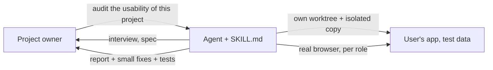

# Architecture

## Overview

`usability-walkthrough` is a single agent skill: one `SKILL.md` with the method, plus a `references/` folder the agent reads only when a phase needs it. There is no code to run and no service to deploy. A thin Claude Code plugin manifest exists only so the skill can be installed with one command.

The skill runs inside the user's agent session, against the user's own project. Everything it touches (worktree, test copy of the app, browser) belongs to that project.

## Components

| Component | Responsibility | Location |
|---|---|---|
| Skill | The method, phase by phase, with the gates between phases | `skills/usability-walkthrough/SKILL.md` |
| References | Interview questions, spec and report templates, trap list, severity scale, measurement snippets | `skills/usability-walkthrough/references/` |
| Plugin manifest | Makes the repo installable as a Claude Code plugin marketplace | `.claude-plugin/` |

## Data flow

1. The owner asks for an audit. The agent interviews them one question at a time until it can state who the end users are, what triggered the audit and what they expect back.
2. The agent writes a spec and waits for approval.
3. The agent creates its own git worktree and starts an isolated copy of the app with test data, on its own ports.
4. It walks each role through its daily tasks in a real browser (phone and desktop), provokes the classic traps and measures.
5. It writes the report, fixes the small findings in the worktree, verifies each fix in the browser and with a test seen failing against the old code.
6. The owner decides on the structural proposals and on committing.

No data leaves the user's machine because of the skill itself. The skill never targets production.

## Where things live

| Path | What |
|---|---|
| `README.md` | What the skill is, how to install and use it |
| `skills/usability-walkthrough/` | The skill |
| `docs/adr/` | Decisions |

## External services

None at runtime. Distribution through GitHub (plugin marketplace) and [skills.sh](https://skills.sh/).

## Decisions

- [ADR-0001: Ship as a plain skill, packaged only for installation](docs/adr/0001-ship-as-a-plain-skill.md)
